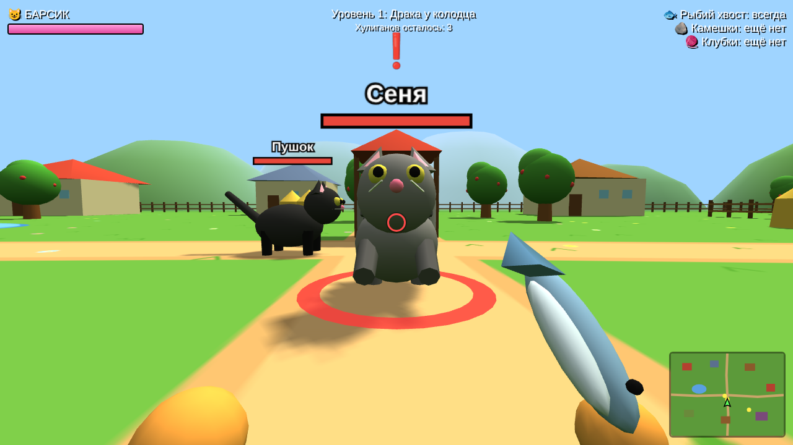
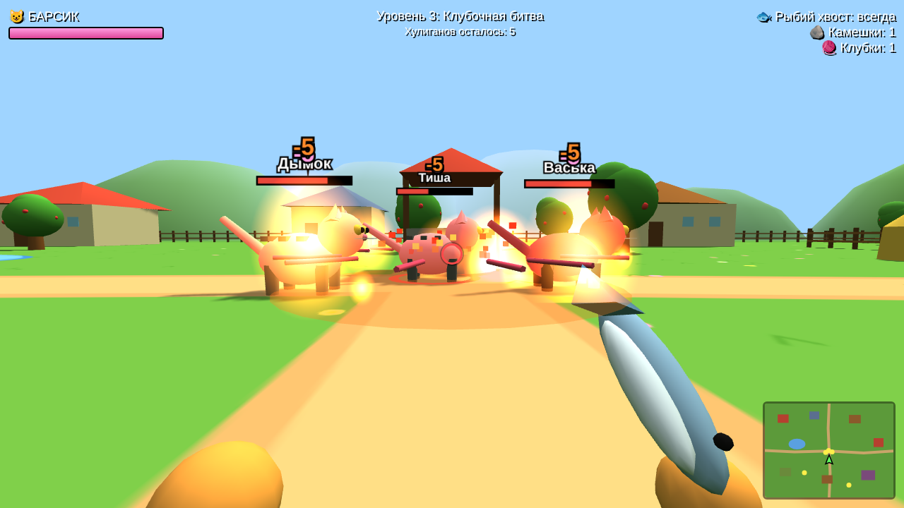
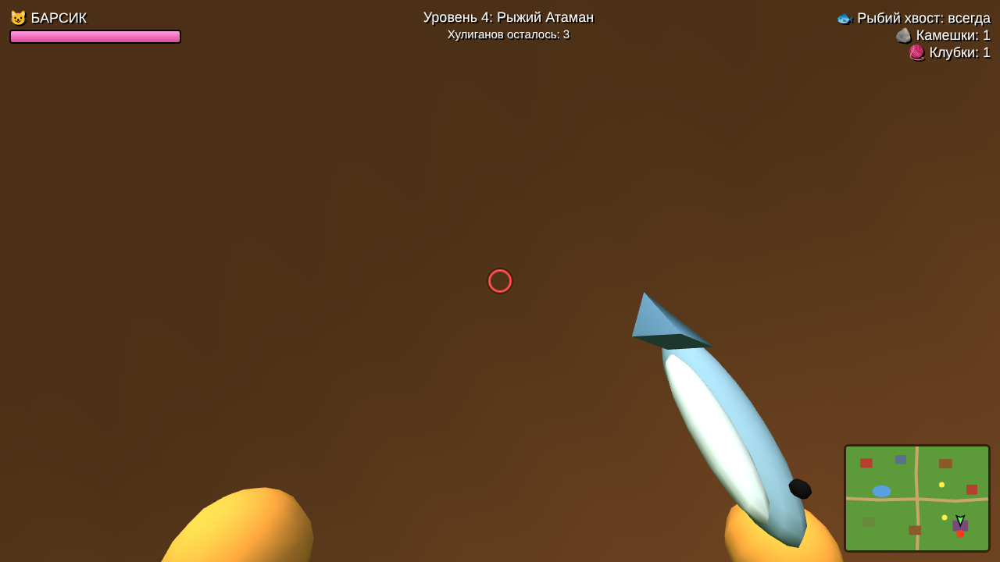

# 🐱 Коты-драчуны

**Играть в браузере: https://aleksarulezzz-lab.github.io/game-of-Demid/**

В деревню Мурлыкино пришла банда дворовых котов во главе с Рыжим Атаманом. Рыжий котик Барсик берёт свою рыбий хвост-дубинку и выходит защищать деревню. 3D, вид из глаз Барсика.

## Управление (только клавиатура)
- **← →** (или A D) — повернуться, **↑ ↓** (или W S) — бежать, **Q E** — шаг вбок
- **Z или Пробел** — удар рыбьим хвостом
- **X** — камешек (в начале 1, за каждого побеждённого хулигана +2). Промахнулся — Барсик сам дерёт траву и кидает её (оглушает)
- **C** — клубок-граната: ниточки −5, огонь рядом −5
- **Enter** — кнопки на экранах

## Что есть
- 4 уровня и добрая концовка, где Рыжий Атаман становится другом
- Игра запоминает пройденный уровень
- Можно записать свой голос («мяу», «бабах», «ой») — в меню кнопка 2

## Файлы
- `index.html` — игра (3D, нужен интернет: движок three.js грузится из сети)
- `vid-sverhu.html` — первая версия с видом сверху ([играть](https://aleksarulezzz-lab.github.io/game-of-Demid/vid-sverhu.html))

Игру придумал Демид, 2026. 🐾
